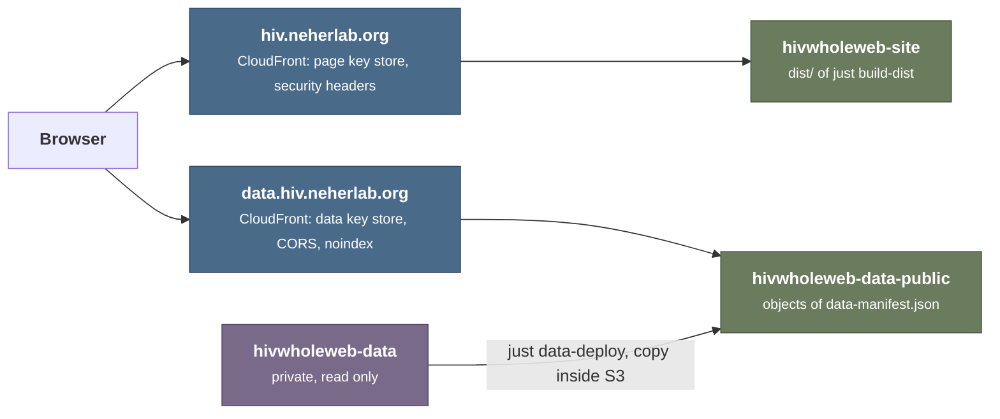

# Hosting

The site has two hosts on AWS CloudFront, each in front of its own S3 bucket: the page host `https://hiv.neherlab.org` serves the pages and static files of `dist/`, and the data host `https://data.hiv.neherlab.org` serves the data. [`docs/development.md`](development.md) describes the build and the commands.

The lab's infrastructure project creates and configures the buckets, the distributions, the certificates, the DNS records, the CI role, and the redirect of the old host name, and it defines the CloudFront Functions and the response headers. This repository holds no infrastructure code: it uploads to S3, fills the key stores, and clears the CloudFront caches.

## Uploads

The upload scripts (`just publish-site`, `just publish-preview`, `just data-deploy`, `just data-verify`) call S3, CloudFront, and the key store API through the AWS SDK for JavaScript, inside the Bun process (`scripts/aws.ts`). Each script sends up to 64 S3 requests at once over reused HTTPS connections, so checking the 2490 objects of the data host takes about 2 seconds. The clients take the region from `AWS_DEFAULT_REGION` and the credentials from the standard AWS variables, which `aws-actions/configure-aws-credentials` sets in CI and `aws-vault exec <profile> --` sets locally; `dev/dev` forwards them into the container.

## Caching

- Files under `static-<hash>/` carry `Cache-Control: public, max-age=31536000, immutable`: browsers keep them forever, and a change of a static file gives a new folder name. Old folders stay in the bucket, so a page that a browser or CloudFront still holds keeps working.
- Every other file of the page host carries `public, max-age=0, must-revalidate, s-maxage=31536000`: CloudFront keeps it until the next deploy clears the cache, and browsers check it on each visit.
- The data objects are immutable, except `index.json` (`public, max-age=300, s-maxage=31536000`) and `robots.txt` (`public, max-age=3600`). Each deploy that writes an object clears the cache of the data host.

So S3 serves few reads: one per CloudFront region after a deploy, plus a read when CloudFront drops a rarely requested file.

## Key stores

Each host has a CloudFront key store with the URL path of every object that it serves. A CloudFront Function of the host passes a request whose path is a key and answers every other path with 404 at the edge, so a flood of random paths never reaches S3. Each deploy uploads the objects that nothing refers to yet, adds the new paths to the store, waits 60 seconds until every edge has them, uploads what refers to them (the pages, or `index.json`), clears the cache, deletes the paths that it no longer serves, and checks the store against the expected paths. The wait exists because a store change reaches the edges only after seconds to tens of seconds, for which AWS publishes no figure, and an edge rejects a path it does not have yet with 404; without the wait, a page fresh from the cache could name scripts that its edge still rejects. The page store keeps the paths of earlier `static-<hash>/` folders. A store holds at most 5 MB, and one update changes at most 50 keys, so the deploy writes in batches, one after another, each with the ETag of the previous one. A read of the store returns at most 50 keys per request, one page after another, at about 0.4 seconds per page, so reading the data store takes about 20 seconds.

The key store API signs with SigV4A (the JavaScript signer of `@aws-sdk/signature-v4a`), which accepts only version 2 session tokens, which regional STS endpoints issue. `aws-vault` and `aws-actions/configure-aws-credentials` use the regional endpoint of their region by default; do not set `sts_regional_endpoints = legacy` for the deploy profile.

## Page host

`https://hiv.neherlab.org` serves the bucket `hivwholeweb-site` (`eu-central-1`). `just publish-site` (`scripts/publish-site.ts`) uploads `dist/` ([Build](development.md#build)) to the bucket root, static files before pages, each file under its path in `dist/`. The page store holds the URL paths of the build: `/` and `/<dir>/` for the pages `index.html` and `<dir>/index.html`, and `/<path>` for every other file except `404.html`. The host needs:

- **Edge rules** (CloudFront Function over the page store): a path under `/api/`, `/static/data/`, or `/static/eti/data/` answers 301 to the data host with the same path and query string; a stored path passes, and a path that ends in `/` reads its `index.html`; a path whose form with `/` appended is stored answers 301 to that form; any other path answers 404 with the site's 404 page
- **404 page**: the object `404.html` for a stored path whose object is missing
- **Cache policy**: follows the objects' `Cache-Control`, without query strings in the cache key
- **Response headers**: those of `server/security-headers.ts`: a Content Security Policy that allows the page host, `https://plausible.io` for the analytics, and the data host for images and requests; `Permissions-Policy`, `Cross-Origin-Opener-Policy: same-origin`, HSTS, `X-Content-Type-Options`, `Referrer-Policy`, and `X-Frame-Options`
- HTTPS only (TLS 1.2 or newer), HTTP/2 and HTTP/3, compression on

## Deployment from CI

`.github/workflows/web.yml` builds and uploads the site on every push; it runs no checks and downloads no data, because the checks run locally ([Commands](development.md#commands)). On pushes to `master`, the production job builds with `HIVWHOLEWEB_PLAUSIBLE_DOMAIN`, assumes the AWS role of the repository variable `HIVWHOLEWEB_SITE_AWS_ROLE_ARN` through GitHub OIDC, and runs `just publish-site`. It fails before the build when `HIVWHOLEWEB_DATA_URL`, `HIVWHOLEWEB_PLAUSIBLE_DOMAIN`, or a `HIVWHOLEWEB_SITE_AWS_*` variable is empty. CI deploys every push to `master` at once, so when a change links new data, run the data deploy before the change reaches `master`.

Every other ref gets preview sites (`.github/scripts/publish-previews`): `neherlab--hivwholeweb--commit-<sha>`, `--branch-<branch>`, and `--pr-<number>` with a pull request comment, each at `https://<site>.previews.neherlab.click`. `just publish-preview` uploads the build once, to the first site, and copies its objects inside the bucket to the other sites, static files before pages, then clears the cache of the preview distribution. Preview builds disallow all crawling and have no analytics. The shared preview distribution belongs to another AWS account and sends its own Content Security Policy, `img-src 'self' blob: data: *.githubusercontent.com`, which blocks the example tree images from the data host on previews; production is not affected.

## Data host

`https://data.hiv.neherlab.org` serves the bucket `hivwholeweb-data-public` (`eu-central-1`, versioning off). Each object is stored under its file path (`storageKey()` in `scripts/manifest.ts`): an API response `/api/<path>` as `api/<path>.json`, its name in `web-data/`, and every other object under its URL path:

- **Objects**: the derived data of `web-data/` ([Repository layout](development.md#repository-layout)) and the files of the data directory ([Data directory](development.md#data-directory)) that the pages link (1761 files, 8.4 GiB, under `static/data/`). The other files of the data directory stay only in the private bucket, so the data host makes public exactly the files that the old server linked. Download files carry `Content-Disposition: attachment`, so that browsers save them under their file names.
- **Archives** under `archives/`: `hivwholeweb-derived-<hash>.zip`, the derived data, deflated (about 10 MiB), and `hivwholeweb-files-<hash>.zip`, the download files, stored without compression (8.4 GiB). Both hold their files at the data host paths, except that API responses keep the `.json` suffix of `web-data/`, and they share no file, so unpacking both into one folder gives the whole data tree. `<hash>` follows the member list, so the name changes only when the members change.
- **Index** `index.json`: the objects of `data-manifest.json` without their sources.
- **Immutable keys**: apart from `index.json` and `robots.txt`, no key ever gets new bytes; new content needs a new key.

The host needs a CloudFront Function over the data store (a stored path passes, a path under `/api/` reads its `.json` object, any other path answers 404), `Access-Control-Allow-Origin: *` for `GET` and `HEAD` without credentials, `X-Robots-Tag: noindex, nofollow`, HSTS, and `X-Content-Type-Options: nosniff` on every answer, a cache policy that follows the objects' `Cache-Control`, HTTPS only, HTTP/2 and HTTP/3, and compression. CORS allows every origin, because the data is public, the scripts read it without credentials, and `*` covers production, previews, and `localhost`.

`just data-manifest` builds the archives that the manifest does not name yet in `tmp/archives/`, then writes the manifest; when the pages link other data files, run it again. `just data-deploy` (`scripts/data-deploy.ts`) writes the objects that are missing or differ: download files by a copy inside S3 from the private bucket `hivwholeweb-data`, other objects from their local files, objects over 5 GiB as multipart uploads with a full-object CRC64NVME checksum. It stops before any write when an object holds other bytes than the manifest names, then adds the new paths to the data store, waits until the edges have them, writes `index.json`, clears the cache, and deletes the paths it no longer serves. `just data-verify` checks the bucket, the index, and the store without writing anything.

## Switch from the old server

1. **Upload the data**, from a checkout that still tracks `web-data/` and has the data directory: `just data-manifest`, then `aws-vault exec --duration=4h neherlab -- just data-deploy`, then `just data-verify`. The files archive is a one-time upload of 8.4 GiB, and the credentials in the container do not refresh, so the session must outlast the upload.
2. **Check the data host**: `index.json` and an API path load, `curl -H 'Origin: https://hiv.neherlab.org'` shows `Access-Control-Allow-Origin: *`, every answer carries `X-Robots-Tag`, an unknown path answers 404 from the edge, both archives answer `HEAD` with 200, and `just data-pull --files` succeeds in a fresh clone.
3. **Stop tracking `web-data/`**, only after steps 1 and 2: add `/web-data/` to `.gitignore` and run `git rm -r --cached web-data`.
4. **Go live**: the first CI run of `master` on the GitHub repository `neherlab/hivwholeweb` deploys `https://hiv.neherlab.org`. Check each page type, a download from each form, the ETI estimate, and the browser console. `curl -i https://hiv.neherlab.org/no-such-page` answers 404 with the site's 404 page, and `https://hiv.neherlab.org/api/data/tree/p1/V3` redirects to the data host.

The old host name `hiv.biozentrum.unibas.ch`, which publications link to, then answers every request with 301 to `https://hiv.neherlab.org`, with the same path and query string.
